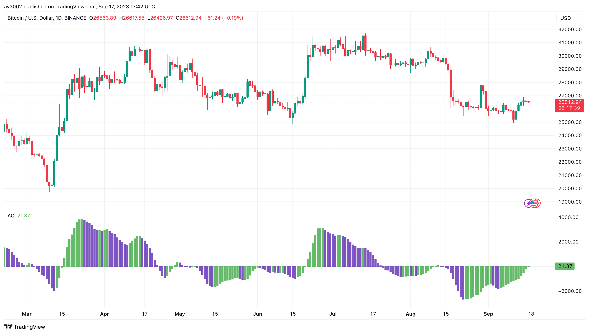
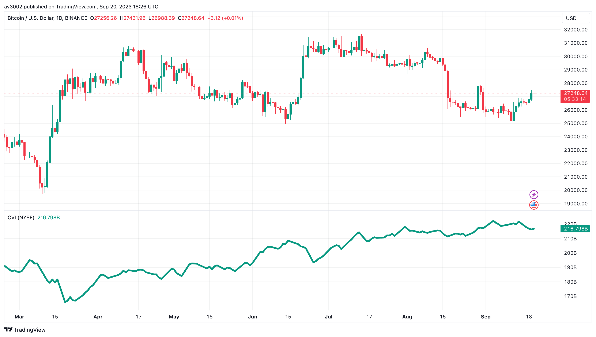
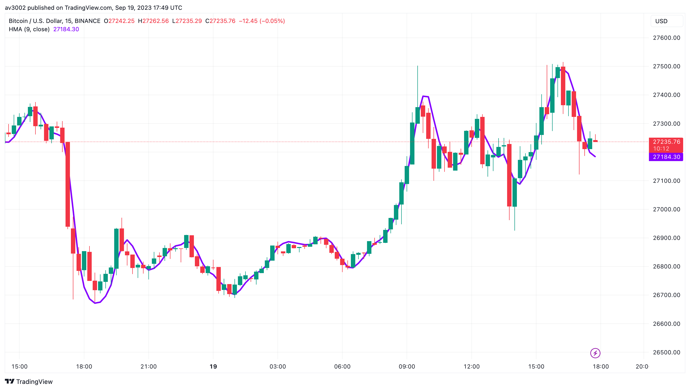
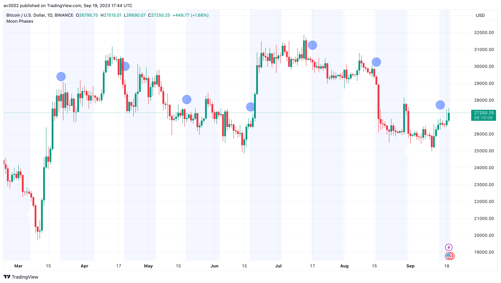
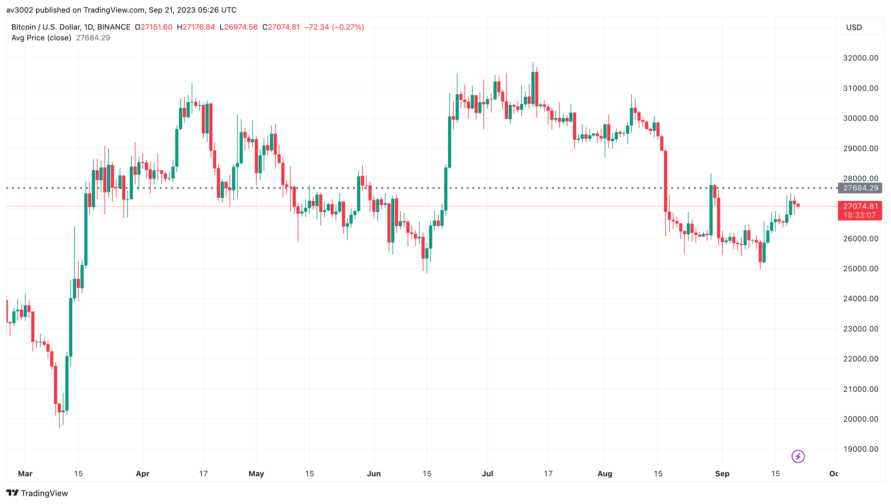

# Pine Strategy Indicators v6

Five open-source TradingView indicators written in Pine Script v6: Awesome Oscillator, Cumulative Volume Index, Hull Moving Average, Moon Phases and Visible Average Price. Part of [GAINZ](https://gainz-trading-indicators.vercel.app), 35 indicators across seven collections.

| Indicator                                           | Type     | Script                                                                    |
| --------------------------------------------------- | -------- | ------------------------------------------------------------------------- |
| [Awesome Oscillator](#awesome-oscillator)           | Momentum | [`awesome-oscillator.pine`](indicators/awesome-oscillator.pine)           |
| [Cumulative Volume Index](#cumulative-volume-index) | Volume   | [`cumulative-volume-index.pine`](indicators/cumulative-volume-index.pine) |
| [Hull Moving Average](#hull-moving-average)         | Trend    | [`hull-moving-average.pine`](indicators/hull-moving-average.pine)         |
| [Moon Phases](#moon-phases)                         | Levels   | [`moon-phases.pine`](indicators/moon-phases.pine)                         |
| [Visible Average Price](#visible-average-price)     | Levels   | [`visible-average-price.pine`](indicators/visible-average-price.pine)     |

## Awesome Oscillator

The gap between a 5-bar and a 34-bar average of each bar's midpoint, drawn as a histogram.

Green bars mean momentum is building, red bars mean it is fading. Alerts fire the moment the colour flips.

| Setting | Default       |
| ------- | ------------- |
| Fast    | 5             |
| Slow    | 34            |
| Alerts  | Colour change |

Based on TradingView's built-in Awesome Oscillator indicator.

## Cumulative Volume Index

A breadth line: the running total of volume in advancing stocks minus volume in declining ones, for the exchange you pick.

When it rises with price, the rally has broad support. When price climbs and the CVI doesn't, fewer stocks are carrying the move.

| Setting  | Default                    |
| -------- | -------------------------- |
| Exchange | NYSE                       |
| Also     | NASDAQ, AMEX, ARCX, US, DJ |

Based on TradingView's built-in Cumulative Volume Index indicator.

## Hull Moving Average

A weighted average built to cut lag almost to nothing while staying smooth.

Its slope is the signal. Turning up, the short-term trend is up. Turning down, it's down.

| Setting | Default |
| ------- | ------- |
| Length  | 9       |
| Source  | Close   |

Based on TradingView's built-in Hull Moving Average indicator.

## Moon Phases

Marks every new moon and full moon on the chart and tints the waxing and waning halves of each cycle.

For traders who study cycles and sentiment. It's a calendar, not a signal: use it to see whether turns line up with the moon.

| Setting | Default |
| ------- | ------- |
| Waxing  | Blue    |
| Waning  | White   |

Based on TradingView's built-in Moon Phases indicator.

## Visible Average Price

The average price of every bar on your screen, redrawn as you scroll and zoom.

A quick fair-value line for the window you're looking at. Above it, price is strong for that view; below it, weak.

| Setting | Default |
| ------- | ------- |
| Source  | Close   |

Based on TradingView's built-in Visible Average Price indicator.

## How to use

1. Open the indicator's `.pine` file in `indicators/` and copy the code.
2. In TradingView, open the Pine Editor, paste the code and save it.
3. Click **Add to chart**, then change the defaults in the indicator's settings.

## Disclaimer

For learning and research. Indicators describe what price has done, not what it will do. Nothing here is financial advice.

## License

[MIT](LICENSE). Indicators based on someone else's work keep their original author's terms.
